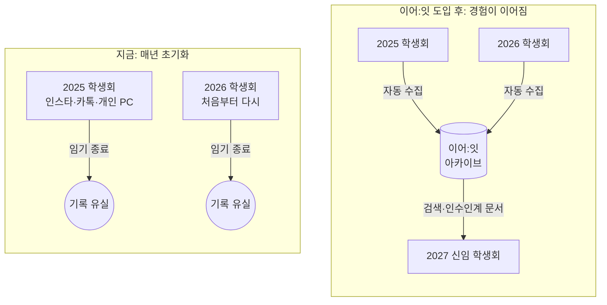
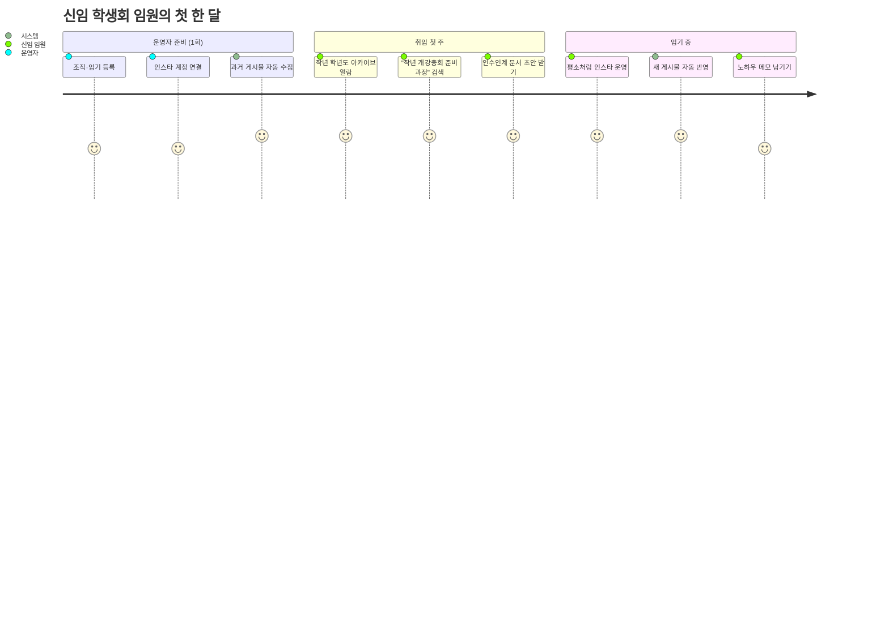
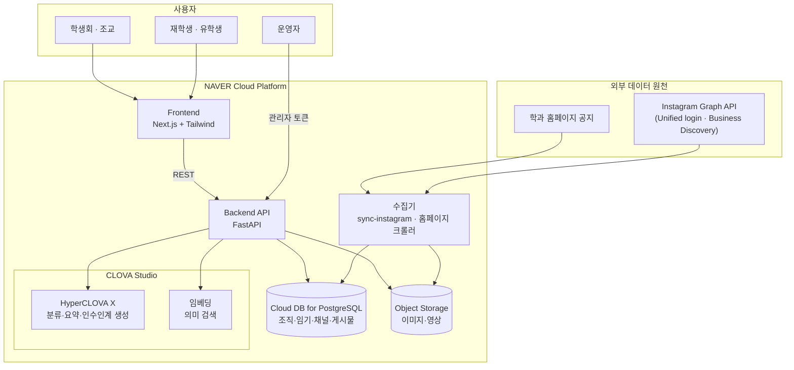
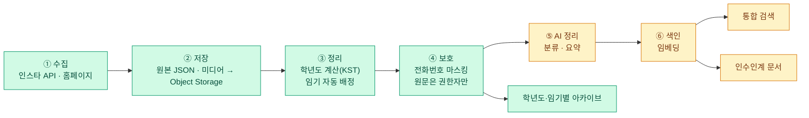
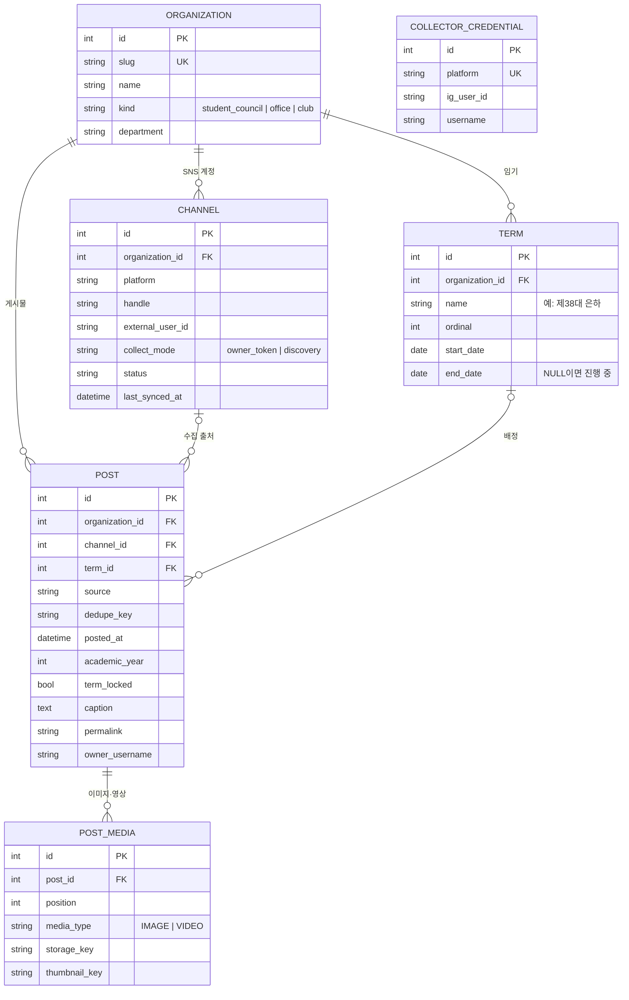
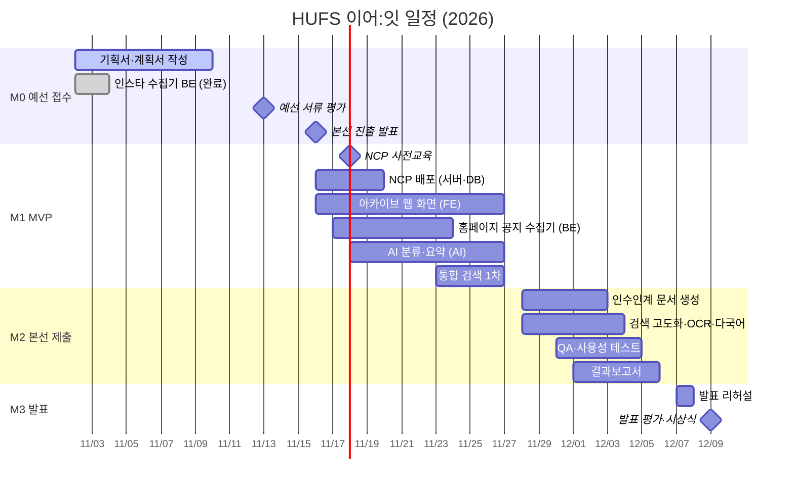
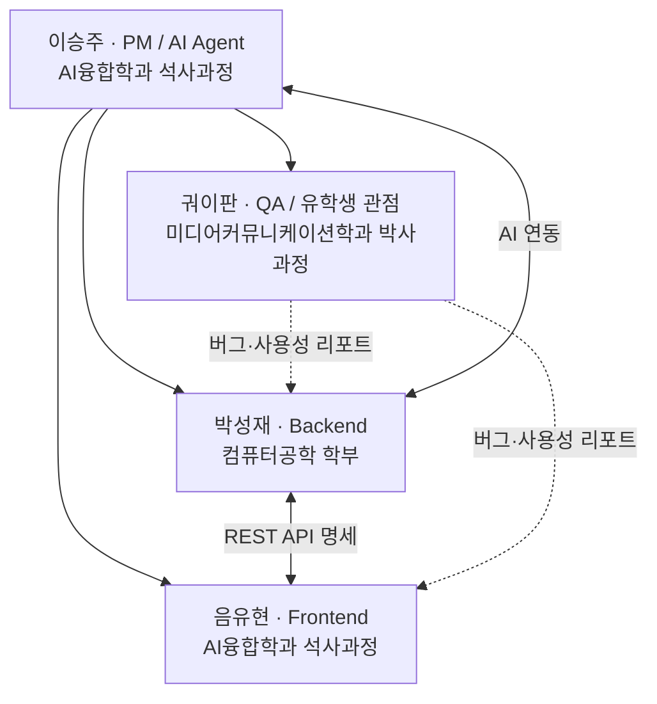

# HUFS 이어:잇 프로젝트 계획서

- 작성: 이승주 (PM)
- 작성일: 2026-11-03
- 상태: 초안 v0.1 — 수정은 PR로 해 주세요.
- 관련 문서: [제안서](proposal.md) · [대회 요약](contest.md) · [인스타 수집기 설계](specs/2026-11-02-instagram-collector-design.md) · [기술 스택 결정](decisions/001-tech-stack.md)

> **"사람은 매년 바뀌지만, 대학의 경험까지 매년 초기화될 필요는 없다."**

---

## 1. 개요

| 항목 | 내용 |
|---|---|
| 한 줄 정의 | 학생회·학과 사무실의 활동 기록을 자동으로 모아 조직·학년도·임기별로 정리하고, AI로 검색과 인수인계를 돕는 아카이빙 플랫폼 |
| 대상 | 한국외대 학생회, 학과 사무실, 재학생(외국인 유학생 포함) |
| 핵심 가치 | **새 업무가 생기지 않는다.** 조직은 지금처럼 인스타·홈페이지를 운영하고, 기록은 플랫폼이 쌓는다. |
| 출품 | 2026 AI 캠퍼스: 바이브코딩 경진대회 (한국외대 × 네이버클라우드) |
| 시범 범위 | 미디어커뮤니케이션학부 3개 계정 (학생회 · 방송제작실습실 · 학부장실) |

### 1.1 목표

1. **예선 통과 (11/10 접수):** 학내 현안 관련성과 AI 활용 계획이 분명한 기획서를 낸다.
2. **본선 MVP (11/27):** 시범 조직의 기록이 자동으로 쌓이고, 학년도·임기별로 보이고, 검색된다.
3. **본선 완성 (12/6):** AI 요약·분류와 인수인계 문서 생성까지 실제 데이터로 시연한다.
4. **발표 (12/9):** "신임 학생회 임원이 첫날 인수인계 문서를 받는" 장면을 라이브로 보여 준다.

### 1.2 성공 지표 (KPI)

목표치는 시범 운영 기준의 팀 내부 목표이며, MVP 이후 실측값으로 고친다.

| 지표 | 목표 | 측정 방법 |
|---|---|---|
| 수집 커버리지 | 시범 3개 계정의 현재 피드 게시물 **100%** 저장 | API `media_count`와 DB 게시물 수 대조 |
| 자동 갱신 | 새 게시물이 **24시간 안에** 아카이브에 반영 | 동기화 로그 |
| 임기 배정 정확도 | 임기가 등록된 기간의 게시물 **100%** 올바른 임기에 배정 | 자동 테스트 + 샘플 수동 검수 |
| 검색 품질 | QA 질문 세트 30개 중 상위 3개 결과 안에 정답 **80% 이상** | `qa/scenarios` 질문 세트 |
| 인수인계 문서 | 문서 1건 생성 **1분 이내**, 사용자 만족도 4/5 이상 | 시범 사용자 설문 |
| 개인정보 | 공개 화면에 전화번호 노출 **0건** | 마스킹 테스트 + QA 점검 |

---

## 2. 문제 정의

### 2.1 현재 상황 (As-Is)

- 학생회와 학과 사무실은 **학기 또는 1년마다 담당자가 바뀐다.**
- 기록은 인스타그램, 학과 홈페이지, 개인 PC, 카톡방에 **흩어져 있다.**
- 인수인계는 담당자 개인 역량에 맡겨지고, 신임자는 **같은 시행착오를 반복한다.**
- 1년간 만든 행사와 성과는 담당자가 떠나면 **찾을 수 없게 된다.**

### 2.2 근거 — 인스타 샘플 분석 (2026-11-02, 3개 계정 34개 게시물)

| 발견 | 의미 |
|---|---|
| 로그아웃 공개 화면에서는 계정당 최근 **약 12개**만 보인다 | 지금 방식으로는 과거 기록을 볼 수 없다 → 공식 API 수집이 필요하다 |
| 실습실 공지의 문의 번호가 **학기마다 바뀐다** | 조교 교체가 실제로 일어난다 → 사무실에도 "임기" 개념이 필요하다 |
| 학부장실 공지의 핵심 정보가 **카드뉴스 이미지 안에** 있다 | 캡션만으로는 검색이 안 된다 → 이미지 OCR이 다음 단계 과제다 |
| 캡션에 **학생회장·조교의 휴대폰 번호**가 있다 | 공개 화면은 마스킹하고, 원문은 권한자만 본다 |
| 같은 공지를 **여러 번** 올린 게시물이 있다 | 묶어서 보여 주는 처리가 필요하다 (후속) |

### 2.3 바뀐 모습 (To-Be)

조직은 지금처럼 SNS와 홈페이지를 운영한다. 플랫폼은 그 기록을 자동으로 모아 **조직 → 학년도 → 임기** 순서로 정리한다. 신임자는 자연어로 과거 기록을 찾고, 버튼 한 번으로 인수인계 문서 초안을 받는다.

---

## 3. 타깃 사용자와 페르소나

| 페르소나 | 상황 | 가장 원하는 것 | 주 사용 기능 |
|---|---|---|---|
| **신임 학생회 임원** (3월 취임) | 작년에 어떤 행사를 언제, 어떻게 했는지 모른다 | "작년 개강총회 준비는 어떻게 했지?"에 대한 답 | 통합 검색, 인수인계 문서 |
| **학과 조교** (학기 단위 교체) | 전임 조교의 공지 이력과 연간 업무 흐름을 알아야 한다 | 학기별 반복 업무 목록 | 학년도·임기별 아카이브, 인수인계 문서 |
| **재학생** | 졸업요건, 학사 공지, 행사 정보를 여러 곳에서 찾는다 | 한곳에서 검색 | 통합 검색 |
| **외국인 유학생** | 한국어 공지와 카드뉴스를 이해하기 어렵다 | 내 언어로 된 요약 | 다국어 요약 (후속) |
| **운영자 (플랫폼 관리자)** | 새 조직과 계정을 붙이고 임기를 등록한다 | 한 번 설정하면 알아서 쌓이는 것 | 관리자 API, 수집 명령 |

---

## 4. 솔루션과 기능 범위

### 4.1 핵심 기능

1. **자동 아카이빙:** 학생회 인스타·학과 홈페이지 공지를 모아 조직·학년도·임기별로 정리
2. **AI 기록 정리:** 행사/업무/공지 자동 분류와 요약 (HyperCLOVA X)
3. **통합 검색:** 자연어로 과거 활동·졸업요건·학사 공지 검색 (CLOVA 임베딩)
4. **인수인계 지원:** 과거 기록과 담당자 메모로 인수인계 문서 초안 생성 (권한자만)

### 4.2 우선순위 (MoSCoW)

| 우선순위 | 기능 | 상태 |
|---|---|---|
| **Must** | 인스타 공식 API 수집 (Business Discovery + 계정 토큰 방식) | ✅ 완료 (BE, push 전) |
| **Must** | 학년도(3/1~2월 말) 계산, 임기 등록·자동 배정 | ✅ 완료 |
| **Must** | 전화번호 마스킹, 관리자 토큰 인증 | ✅ 완료 |
| **Must** | 아카이브 조회 API (조직 목록, 학년도별 개수, 임기별 게시물) | ✅ 완료 |
| **Must** | 아카이브 웹 화면 (조직 → 학년도 → 임기 → 게시물) | ⬜ FE |
| **Must** | AI 분류·요약 | ⬜ AI |
| **Must** | 통합 검색 (임베딩 + 키워드) | ⬜ AI/BE |
| **Must** | 인수인계 문서 생성 | ⬜ AI |
| **Must** | NCP 배포 (Server, Cloud DB, Object Storage) | 🔶 Object Storage 연동 완료, 서버 배포 전 |
| **Should** | 학과 홈페이지 공지 수집기 | ⬜ BE |
| **Should** | 담당자 노하우 직접 등록 (메모·파일) | ⬜ BE/FE |
| **Should** | 정기 자동 동기화 (스케줄러) | ⬜ BE |
| **Could** | 카드뉴스 이미지 OCR (CLOVA OCR) | ⬜ AI |
| **Could** | 다국어 요약 (영어·중국어) | ⬜ AI/QA |
| **Could** | 중복 게시물 묶어 보기 | ⬜ FE |
| **Could** | 인스타 "내 정보 다운로드" 파일 가져오기 | ⬜ BE |
| **Won't (이번 대회)** | 비공식 스크래핑 | 이용약관 위반 위험으로 하지 않음 |
| **Won't (이번 대회)** | 개인 포트폴리오 생성 | 확장 아이디어로만 소개 |

---

## 5. 시스템 설계

도식은 Mermaid로 그렸습니다. GitHub에서 바로 그림으로 보입니다.

### 5.1 문제와 해결 개념도

### 5.2 사용자 여정도

### 5.3 시스템 아키텍처

### 5.4 데이터 파이프라인

초록색은 구현 완료, 노란색은 본선 기간에 만들 부분입니다.

### 5.5 데이터 모델 (ERD)

현재 `backend/app/models.py` 기준입니다. AI 단계에서 요약·분류·임베딩 테이블을 추가합니다.

`COLLECTOR_CREDENTIAL`은 Business Discovery로 공개 프로페셔널 계정을 조회할 때 쓰는 우리 수집용 계정입니다. 다른 테이블과 관계가 없습니다.

### 5.6 주요 API (구현 완료)

| 구분 | 메서드·경로 | 설명 |
|---|---|---|
| 공개 | `GET /organizations` | 조직 목록 |
| 공개 | `GET /organizations/{slug}/years` | 학년도별 게시물 수 |
| 공개 | `GET /organizations/{slug}/archive?academic_year=2026` | 임기별로 묶은 게시물 |
| 공개 | `GET /media/{key}` | 이미지·영상 |
| 관리자 | `POST /organizations`, `POST·PATCH·DELETE …/terms` | 조직·임기 관리 (임기 겹침 거부, 게시물 재배정) |
| 관리자 | `PATCH /posts/{id}` | 게시물 임기 수동 고정 |
| 관리자 | `GET …/instagram/connect-url`, `DELETE /channels/{id}` | 계정 연결 링크 발급, 연결 해제와 데이터 삭제 |

---

## 6. 데이터·보안·정책

| 원칙 | 적용 |
|---|---|
| 공식 API만 사용 | Instagram Graph API(Unified login, Business Discovery). 비공식 스크래핑은 하지 않는다. |
| 운영자 동의 | 계정 토큰 방식은 계정 운영자가 직접 로그인해 연결한다. 연결 해제 시 데이터도 지운다. |
| 개인정보 보호 | 공개 응답의 전화번호는 `010-XXXX-XXXX`로 가린다. 원문은 권한자만 본다. |
| 비밀값 관리 | 토큰은 암호화해 저장한다. API 키는 `.env`에만 두고 레포에 올리지 않는다(공개 레포). |
| 데이터 최소화 | `instagram_basic` 권한만 쓴다. 광고·DM·댓글·게시 권한은 쓰지 않는다. |
| 내부 자료 권한 | 인수인계 원문과 담당자 메모는 권한 있는 사용자만 본다. |
| AI 이용약관 | CLOVA Studio·Claude·ChatGPT 이용약관을 지킨다(위반 시 수상 제외 규정). AI 도구에 개인정보를 넣지 않는다. |

---

## 7. 일정과 마일스톤

| 마일스톤 | 기한 | 완료 조건 |
|---|---|---|
| **M0 예선 접수** | 11/10 | 참가신청서·기획서·동의서 2종 제출 |
| **M1 MVP** | 11/27 | NCP에 배포된 웹에서 시범 3개 계정의 학년도·임기별 아카이브를 보고, 검색이 동작한다 |
| **M2 본선 제출** | 12/6 | 인수인계 문서 생성까지 실제 데이터로 시연 가능, QA 시나리오 통과, 결과보고서 제출 |
| **M3 발표** | 12/9 | 10분 발표 + 라이브 데모 + Q&A 5분 |

---

## 8. 조직과 역할 (R&R)

| 담당 | 역할 | 주요 업무 | 주 작업 폴더 | 산출물 |
|---|---|---|---|---|
| **이승주** | PM · AI Agent | 일정·이슈 관리, 기획서·결과보고서, 학생회·학과 데이터 확보, CLOVA Studio 연동(분류·요약·검색·인수인계 생성) | `docs/`, `backend/app/ai/` | 기획서, 계획서, AI 모듈, 발표 자료 |
| **박성재** | Backend | API, DB, 수집기, NCP 배포 | `backend/` | 수집기, REST API, 배포 환경 |
| **음유현** | Frontend | 아카이브 페이지, 검색 UI, 인수인계 문서 화면 | `frontend/` | 웹 화면 |
| **궈이판** | QA · 유학생 관점 | 테스트 시나리오, 버그 리포트, 사용성 검증, 유학생 사용자 검증과 다국어 품질 확인, 발표 데모 리허설 | `qa/` | QA 시나리오, 사용성 리포트 |

- 팀 구성: 4인 (대회 규정 최대 5인)
- 학부·석사·박사 과정이 함께하고, 컴퓨터공학·AI융합·미디어커뮤니케이션 전공이 섞여 있다. 시범 조직인 미디어커뮤니케이션학부와 연결점이 있다.

---

## 9. 리스크 관리

| # | 리스크 | 가능성 | 영향 | 대응 |
|---|---|---|---|---|
| R1 | Meta API 정책·권한 변경 (11/3 Unified login 전환 사례) | 중 | 상 | Business Discovery와 계정 토큰 두 경로를 유지한다. "내 정보 다운로드" 가져오기를 예비로 둔다. |
| R2 | API가 `caption`이나 공동 게시물을 돌려주지 않음 | 중 | 상 | 첫 연동 직후 확인한다. 안 되면 수집 방식을 다시 검토한다. |
| R3 | 시범 조직의 협조(계정 연결·임기 정보)를 늦게 받음 | 중 | 중 | Business Discovery는 공개 프로페셔널 계정이면 로그인 없이 수집된다. 임기 정보는 공개 게시물로 먼저 추정한다. |
| R4 | 핵심 정보가 이미지 안에 있어 검색 품질이 낮음 | 상 | 중 | CLOVA OCR을 Could에서 Should로 올리는 것을 M1 회고에서 결정한다. |
| R5 | 개인정보 노출 | 하 | 상 | 마스킹 테스트를 자동화하고, QA 체크리스트에 넣는다. |
| R6 | 일정 부족 (본선 개발 3주) | 상 | 상 | MoSCoW의 Must만 M1에 넣는다. 매주 범위를 다시 확인한다. |
| R7 | CLOVA Studio 비용·호출 한도 | 중 | 중 | 요약은 수집 시 1회만 생성해 저장한다. 사전교육(11/18)에서 한도를 확인한다. |

---

## 10. 심사 기준별 대응

### 10.1 1차 서류 (100점)

| 항목 | 배점 | 우리의 근거 |
|---|---|---|
| 한국외대 현안 관련성 | 40 | 실제 학부 계정 3개의 샘플 분석(조교 교체, 연락처 노출, 기록 유실). 학생회·학과 사무실의 매년 반복되는 인수인계 문제 |
| 주제의 독창성·창의성 | 30 | "새 업무가 없는" 자동 아카이빙. 학년도와 별개로 **임기** 단위로 기록을 이어 붙이는 구조 |
| 적절한 AI 기술 활용성 | 30 | HyperCLOVA X로 분류·요약·인수인계 문서 생성, 임베딩 검색. 바이브코딩으로 실제 수집기를 먼저 만들어 둠 |

### 10.2 2차 발표 (100점) + 가점

| 항목 | 배점 | 준비 |
|---|---|---|
| 구현 완성도·실현 가능성 | 30 | 실제 계정 데이터로 라이브 데모. 자동 테스트 227개(현재 BE) |
| 학내 적용(정책화) 가능성 | 30 | 단과대·학과·자치기구로 확대하는 로드맵. 공식 API·동의 기반이라 학교가 바로 도입 가능 |
| 아이디어 파급효과 | 25 | 업무 연속성, 학생 활동 가치 보존, 유학생 정보 접근성 |
| 발표 구성·전달 | 15 | 신임 임원 페르소나 하나로 이어지는 스토리 데모 |
| **NCP 가점** | +5 | CLOVA Studio + Server + Cloud DB + Object Storage 사용 |

---

## 11. 현재 진척 (2026-11-03)

- ✅ 인스타 수집기 백엔드 완성 (`feat/instagram-collector`, 자동 테스트 227개 통과, **아직 push 전**)
  - Business Discovery(기본)와 계정 토큰 방식, 학년도·임기 배정, 마스킹, 로컬·NCP 미디어 저장
- ✅ 기술 스택 결정 ([001](decisions/001-tech-stack.md))
- ⬜ 프론트엔드 착수 전
- ⬜ AI 모듈 착수 전

### 다음 할 일

1. 기획서 최종본 작성과 예선 접수 (~11/10, 이승주)
2. 인스타 수집기 브랜치 PR 올리고 리뷰 (박성재)
3. 시범 3개 계정 실연동으로 R2 확인 (박성재)
4. 아카이브 화면 와이어프레임 (음유현)
5. QA 질문 세트 30개 초안: 한국어·영어·중국어 (궈이판)
6. CLOVA Studio 분류 체계와 프롬프트 초안 (이승주)
